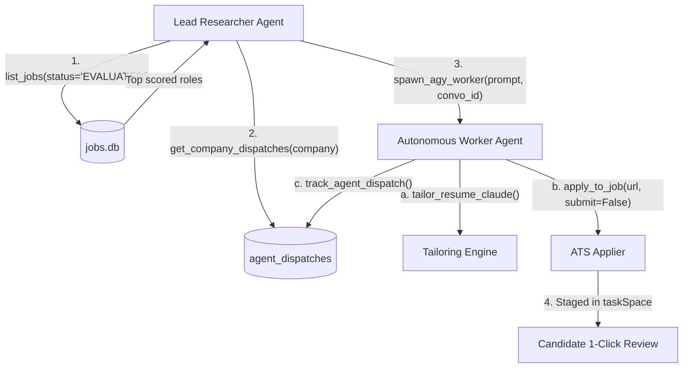

# Job Master Applier & Autonomous Hunting Platform Guide

## 1. System Overview & Architecture

This platform provides an end-to-end autonomous job discovery, evaluation, dynamic LaTeX resume tailoring, and automated application system.

- **Repository Root:** Dynamic via `JOB_APPLIER_ROOT` environment variable or git workspace root.
- **Master CLI:** [`cli.py`](file:///Users/adarsh/job_finder_applier/cli.py)
- **Database:** SQLite at `data/jobs.db` with WAL mode enabled.
- **MCP Server:** [`engine/mcp/agy_terminal_mcp.py`](file:///Users/adarsh/job_finder_applier/engine/mcp/agy_terminal_mcp.py) (13 JSON-RPC tools).
- **Daemon Watcher:** macOS `launchd` service `com.adarsh.ai_auto_applier` running 24/7 via `~/Library/LaunchAgents/com.adarsh.ai_auto_applier.plist`.

### Non-Negotiable Operational Principles
1. **Dynamic Candidate Credentials:**
   All candidate details (name, email, phone, LinkedIn, GitHub, location, expected CTC, form answers) load dynamically from `.env` via [`engine/config.py`](file:///Users/adarsh/job_finder_applier/engine/config.py). Never hardcode credentials into scripts or commit them to git.
2. **Zero-Placeholder Circuit Breaker:**
   `assert_real_candidate_profile()` runs before staging or applying. If placeholder values exist, execution halts immediately.
3. **Strict 1-Page XeTeX Rule:**
   All tailored resumes must compile to strictly **exactly 1 page** (verified via `engine.claude_tailor.get_pdf_page_count`). Zero whitespace gaps at the bottom; zero overflow onto page 2.
4. **Two-Tier Submission Policy:**
   - **Remote Contracts / Freelance:** Approved for immediate **`AUTO_SUBMIT`**.
   - **Full-Time India Roles:** Enforce **`STAGE_AND_VALIDATE`**. Fill 100% of the form, attach the tailored PDF, and leave the submit button enabled for user 1-click review.
5. **No Anti-Bot or CAPTCHA Bypassing:**
   Never attempt to solve or bypass CAPTCHAs or Cloudflare Turnstile. Leave staged in ego-browser for user manual completion.

---

## 2. Ego-Browser Profiles & Jargon Matrix

Ego-browser maintains separate Chromium profiles to isolate authenticated web sessions and prevent re-authentication popups:

| Profile Identifier | User Jargon / Account | Intended Services & Portals |
|---|---|---|
| **`Profile 1`** | **"Main Account" / "Personal Profile"** | ChatGPT (`chatgpt.com`), Mercor, DataAnnotation, Turing, Alignerr, Microsoft Careers, Personal Gmail, Stripe, Ashby |
| **`Profile 2`** | **"College Profile"** | LinkedIn (`linkedin.com/jobs`), College Gmail, Overleaf LaTeX Editor (`overleaf.com`), University/Academic application portals |
| **`Default`** | **"Daily Workload"** | High-volume ATS scrapers (Greenhouse, Lever), unauthenticated career boards, daily batch staging |

### Profile & Account CLI Commands:
```bash
# List all services and their assigned profiles
python3 cli.py list-accounts

# Open a service directly in its assigned profile
python3 cli.py switch-account --service chatgpt
python3 cli.py switch-account --service mercor
python3 cli.py switch-account --service linkedin
python3 cli.py switch-account --service personal_gmail
python3 cli.py switch-account --service college_gmail

# Check recent emails from an inbox
python3 cli.py check-emails --profile personal --limit 5
python3 cli.py check-emails --profile college --limit 5
```

---

## 3. Master Resumes & Specialization Archetypes

All master templates reside in [`master_resumes/`](file:///Users/adarsh/job_finder_applier/master_resumes) and compile to 1 page via Tectonic:

### 3.1 The 4 Specialization Archetypes
1. **`RESUME_1_AI_ENGINEER.tex`** (`master_resumes/RESUME_1_AI_ENGINEER.tex`):
   - **Domain:** AI Engineering, GenAI, LLM Systems, Multi-Agent Orchestration, RAG.
   - **Key Focus:** Voice AI agents, Lambda prompt caching, Text-to-SQL MCP engines, document intelligence, PyTorch.
2. **`RESUME_2_DATA_ENGINEER.tex`** (`master_resumes/RESUME_2_DATA_ENGINEER.tex`):
   - **Domain:** Data Platform, Distributed Lakehouse, Near-Real-Time CDC & ETL/ELT.
   - **Key Focus:** Apache Spark, AWS Glue, Kafka CDC (Debezium), Apache Hudi, Parquet, petabyte-scale lakehouse engineering.
3. **`RESUME_3_SWE_BACKEND.tex`** (`master_resumes/RESUME_3_SWE_BACKEND.tex`):
   - **Domain:** Backend Software Engineering, High-Throughput Microservices, Distributed Systems.
   - **Key Focus:** FastAPI REST APIs, Go/Python microservices, Docker, Kubernetes telemetry, ACID transactions, PostgreSQL, Redis.
4. **`RESUME_4_GENERAL_ENGINEERING.tex`** (`master_resumes/RESUME_4_GENERAL_ENGINEERING.tex`):
   - **Domain:** General Software Engineering, Core Algorithms, Full-Stack Foundation.
   - **Key Focus:** Full-stack development, CS fundamentals, competitive programming, high-scalability platforms.

### 3.2 Master Dossier & Tailoring Rules
- **Master Dossier:** [`master_resume/MASTER_PROFILE.md`](file:///Users/adarsh/job_finder_applier/master_resume/MASTER_PROFILE.md) contains verified metrics, architecture details, and project accomplishments.
- **When to Tailor:**
  - Tailor via Claude Sonnet 3.5 when the target is a Tier-1 company FTE position or a high-suitability remote contract role.
  - Otherwise, select the best matching specialization archetype directly via `select_specialization_resume()` and compile with injected candidate `.env` credentials.

### 3.3 Battle-Tested ATS Scoring Rules (Resume Worded 85–90+ Benchmark)
Empirically validated against Resume Worded's ATS reviewer:
1. **Strict Action Verb Uniqueness (ATS Impact 10/10):**
   - NEVER repeat ANY action verb across experience or project bullets. Using an action verb more than twice reduces the ATS score from 85+ down to 70.
   - Rotated verb palette: *Architected, Automated, Engineered, Constructed, Spearheaded, Pioneered, Tuned, Formulated, Created, Deployed, Developed, Authored*.
2. **Zero Forbidden Buzzwords & Clichés:**
   - Never use vague buzzwords flagged by ATS screeners: `"dynamic"`, `"cutting-edge"`, `"world-class"`, `"synergy"`.
   - Replace *"dynamic resource allocation"* with *"adaptive resource allocation"* or *"runtime compute scaling"*.
   - Replace *"dynamic resume tailoring"* with *"automated schema-driven resume tailoring"*.
3. **ATS Fontspec & Ligature Safety:**
   - Always include `\defaultfontfeatures{Ligatures={NoCommon}}` when compiling with XeTeX/Tectonic.
   - Without this, standard ligatures like `fi` (in *Artificial*, *verification*, *classified*) are parsed by ATS text extractors as curly braces `{` (e.g. `Arti{cial`), causing severe readability and spelling penalties.
4. **Clean Bold Whitespace Isolation:**
   - Guarantee explicit ASCII spaces before and after all `\textbf{...}` tags so text extractors do not fuse neighboring words into unparseable strings.

---

## 4. ChatGPT Consultation Engine (Profile 1)

The platform interacts with the candidate's authenticated ChatGPT session in **Profile 1**:
- **Codepath:** [`engine/chatgpt_consultant.py`](file:///Users/adarsh/job_finder_applier/engine/chatgpt_consultant.py)
- **Functions:**
  - `query_chatgpt(prompt, timeout_sec)`: Direct prompt consultation.
  - `generate_application_pitch(company, title, jd)`: 3-sentence application pitch grounded in candidate experience metrics.
  - `ask_chatgpt_for_application_answers(form_questions, company, title, jd)`: Strict JSON form field answers.

---

## 5. Memorized Application Procedures

The engine memorizes ATS characteristics, form schemas, and application procedures to eliminate guesswork:
- **Registry:** [`engine/procedure_registry.py`](file:///Users/adarsh/job_finder_applier/engine/procedure_registry.py)
- **Supported ATS:** Ashby, Greenhouse, Lever, Workday, Microsoft Careers, Stripe, Mercor.
- **Commands:**
```bash
python3 cli.py list-procedures
python3 cli.py show-procedure --company Inngest
python3 cli.py record-procedure --company Inngest --ats ashby --policy STAGE_AND_VALIDATE
```

---

## 6. Model Context Protocol (MCP) Server

The MCP server resides in [`engine/mcp/agy_terminal_mcp.py`](file:///Users/adarsh/job_finder_applier/engine/mcp/agy_terminal_mcp.py) and provides 13 tools:

| Tool | Purpose |
|---|---|
| `list_jobs` | Query SQLite `jobs.db` with status, priority, and limit filters. |
| `get_job_details` | Retrieve complete job record, JD text, and fit scores. |
| `spawn_agy_worker` | Spawn unattended AGY subagent session with conversation ID resumption. |
| `consult_chatgpt` | Query authenticated ChatGPT session in Profile 1. |
| `generate_application_pitch` | Generate 3-sentence application pitch. |
| `apply_to_job` | Execute automated ATS form filling and resume attachment. |
| `tailor_resume_claude` | Synthesize tailored 1-page LaTeX resume via Claude Sonnet 3.5 and compile via Tectonic. |
| `switch_browser_account` | Open service in assigned profile (`Profile 1`, `Profile 2`, `Default`). |
| `check_inbox_emails` | Check recent emails from personal or college Gmail. |
| `record_apply_procedure` | Memorize company ATS quirks and form parameters. |
| `track_agent_dispatch` | Record agent dispatch & conversation ID in `agent_dispatches`. |
| `get_company_dispatches` | Query past conversation threads for any company. |
| `get_daemon_status` | Inspect launchd daemon status and watcher logs. |

---

## 7. Multi-Agent Delegation Protocol

When operating autonomously, agents follow the **Lead Researcher $\rightarrow$ Autonomous Worker** delegation pattern:



1. **Lead Researcher:** Discovers roles, evaluates scores, checks prior threads via `get_company_dispatches(company)`.
2. **Autonomous Worker:** Invoked via `spawn_agy_worker`, resumes existing company threads, executes resume synthesis and form filling, and records the outcome via `track_agent_dispatch`.
