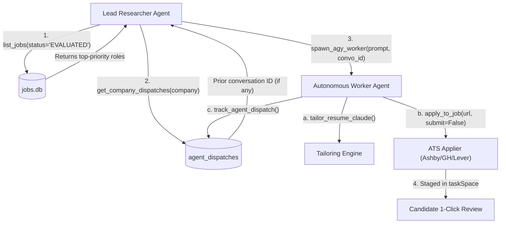

# Model Context Protocol (MCP) Server Specification & Agent Rules

This document specifies the architecture, protocol rules, tool definitions, and multi-agent delegation patterns for the **`job-applier-terminal`** MCP Server.

---

## 1. Protocol Architecture & Transport Specification

The MCP server resides in [`engine/mcp/agy_terminal_mcp.py`](file:///Users/adarsh/job_finder_applier/engine/mcp/agy_terminal_mcp.py) and speaks **JSON-RPC 2.0** over **stdio** transport.

### 1.1 Dual-Mode Transport Framing
To guarantee seamless interoperability across diverse MCP host environments (Claude Desktop, Antigravity/AGY, Cursor, Windsurf, custom Python harnesses), the server implements dual-mode framing:
1. **Header-Delimited Framing (LSP / Standard MCP Spec):**
   ```http
   Content-Length: 123\r\n\r\n{"jsonrpc": "2.0", ...}
   ```
2. **Line-Delimited JSON (NDJSON):**
   ```json
   {"jsonrpc": "2.0", ...}\n
   ```

### 1.2 Protocol Integrity Rule
- **Standard Output (`sys.stdout`) is strictly reserved for JSON-RPC messages.**
- All diagnostic logging, warnings, and error traces **MUST write exclusively to `sys.stderr`**.

---

## 2. Server Installation & Client Configuration

### 2.1 Antigravity (AGY) / Gemini CLI
Add to `~/.gemini/config/mcp_config.json`:
```json
{
  "mcpServers": {
    "job-applier-terminal": {
      "command": "python3",
      "args": ["/Users/adarsh/job_finder_applier/engine/mcp/agy_terminal_mcp.py"],
      "env": {
        "PYTHONUNBUFFERED": "1"
      }
    }
  }
}
```

### 2.2 Claude Desktop (`claude_desktop_config.json`)
```json
{
  "mcpServers": {
    "job-applier": {
      "command": "python3",
      "args": ["/absolute/path/to/job_finder_applier/engine/mcp/agy_terminal_mcp.py"],
      "env": {
        "PYTHONUNBUFFERED": "1"
      }
    }
  }
}
```

### 2.3 Cursor / Windsurf (`.cursor/mcp.json` or project root `mcp.json`)
```json
{
  "mcpServers": {
    "job-applier-terminal": {
      "command": "python3",
      "args": ["engine/mcp/agy_terminal_mcp.py"],
      "env": {
        "PYTHONUNBUFFERED": "1"
      }
    }
  }
}
```

---

## 3. Tool Reference Index (13 Tools)

| Tool Name | Scope & Purpose | Input Parameters | Return Value |
|---|---|---|---|
| `list_jobs` | Query SQLite `jobs.db` with status, priority, and company filters. | `status`, `priority`, `limit` | JSON array of job summaries with match scores. |
| `get_job_details` | Retrieve full job record including raw JD text, scores, and application paths. | `job_id` | Complete job metadata JSON. |
| `spawn_agy_worker` | Spawn unattended AGY subagent CLI session (`agy -p ... --dangerously-skip-permissions`). | `task_prompt`, `working_dir`, `conversation_id`, `effort`, `timeout_sec` | Combined stdout/stderr output from worker. |
| `consult_chatgpt` | Query candidate's authenticated ChatGPT session in Profile 1. | `prompt`, `timeout_sec` | Plaintext / JSON response from ChatGPT. |
| `generate_application_pitch` | Generate 3-sentence application pitch grounded in candidate experience metrics. | `company`, `title`, `jd` | 3-sentence application pitch text. |
| `apply_to_job` | Execute automated application flow via company's memorized procedure. | `url`, `company`, `submit`, `resume_path` | Execution logs and staging confirmation. |
| `tailor_resume_claude` | Synthesize 1-page ATS LaTeX resume customized to JD and compile via Tectonic. | `job_id`, `company`, `title` | Status, TeX path, and compiled PDF path. |
| `switch_browser_account` | Open service in assigned ego-browser profile (`Profile 1`, `Profile 2`, `Default`). | `service`, `url` | JSON navigation confirmation. |
| `check_inbox_emails` | Read recent emails from personal or college Gmail inboxes. | `profile` (`personal` or `college`), `limit` | JSON array of parsed email objects. |
| `record_apply_procedure` | Memorize or update application procedure in `engine/procedure_registry.py`. | `company`, `domain`, `ats_platform`, `submission_policy`, `notes` | JSON confirmation of recorded procedure. |
| `track_agent_dispatch` | Record agent dispatch & conversation ID into SQLite `agent_dispatches`. | `company`, `conversation_id`, `agent_type`, `job_id`, `role_title`, `status`, `notes` | Dispatch ID and confirmation string. |
| `get_company_dispatches` | Query prior conversation IDs and statuses for any company. | `company` | JSON array of prior dispatch records. |
| `get_daemon_status` | Inspect 24/7 background `launchd` daemon status and recent watcher logs. | None | JSON object with launchd state and recent logs. |

---

## 4. Multi-Agent Delegation Protocols

### 4.1 The Two-Agent Pattern (Researcher $\rightarrow$ Worker)
When performing autonomous job hunting and applying, AI agents should operate under a clear division of responsibility:



1. **Lead Research Agent:**
   - Queries `list_jobs(status="EVALUATED", priority="CRITICAL_PRIORITY")` to find high-scoring matches.
   - Calls `get_company_dispatches(company)` to check if a conversation thread already exists for that company.
   - Evaluates whether tailoring is required (Tier-1 FTE or remote contract).
   - Dispatches worker tasks via `spawn_agy_worker` or directly calls `tailor_resume_claude` and `apply_to_job`.

2. **Autonomous Worker Agent (`spawn_agy_worker`):**
   - Inherits workspace context and resumes existing company conversation threads using `--conversation <id>`.
   - Executes DOM form filling, attaches the compiled 1-page PDF, and validates submission state.
   - Records outcome into SQLite table `agent_dispatches` via `track_agent_dispatch`.

---

## 5. Non-Negotiable Operational Safety Rules

1. **Zero Credential Hardcoding:**
   - All candidate information (names, emails, phone numbers, CTC, locations) loads dynamically from `.env` via `engine/config.py`.
   - Never commit `.env` or paste candidate credentials into code, markdown, or prompts.
2. **Strict 1-Page XeTeX Format:**
   - All tailored resumes must compile strictly to **exactly 1 page** (verified via `engine.claude_tailor.get_pdf_page_count`).
   - Must have **zero whitespace gaps** at the bottom and **zero page-2 spillover**.
3. **Two-Tier Submission Policy:**
   - **Remote Contracts:** Approved for `AUTO_SUBMIT`.
   - **Full-Time India Roles:** Enforce `STAGE_AND_VALIDATE`. Pre-fill 100% of fields in ego-browser, attach the resume, and leave the submit button enabled for user review.
4. **Anti-Bot & CAPTCHA Compliance:**
   - Never attempt to programmatically bypass CAPTCHAs, Cloudflare Turnstile, or anti-bot gates. Leave staged in ego-browser for user completion.
