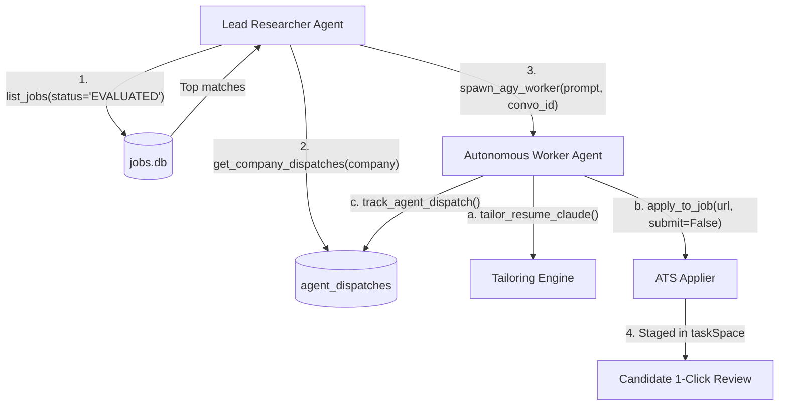

# Autonomous Job Finder, Tailorer & Multi-Agent Applier Platform

[](MCP_RULES.md)
[](master_resumes/)
[](cli.py)
[](LICENSE)

An autonomous, multi-tier AI job hunting, evaluation, dynamic LaTeX resume tailoring, and multi-company auto-apply system. Designed for high-scale software and AI engineering roles, featuring **Model Context Protocol (MCP)** integration, **Claude Sonnet 3.5** resume synthesis, **ChatGPT** strategic consultation, **ego-browser** profile isolation, and **unattended multi-agent delegation**.

---

## 1. System Architecture & Features

```
┌─────────────────────────────────────────────────────────────────────────────────────────┐
│                               MASTER CLI & ORCHESTRATOR                                 │
│                                      (cli.py)                                           │
└───────────────────────────────────────────┬─────────────────────────────────────────────┘
                                            │
        ┌───────────────────────────────────┼───────────────────────────────────┐
        ▼                                   ▼                                   ▼
┌──────────────────┐               ┌──────────────────┐               ┌──────────────────┐
│   MCP SERVER     │               │  BROWSER ENGINE  │               │ RESUME SYNTHESIS │
│ (13 JSON-RPC     │               │  (ego-browser)   │               │ (Claude + TeX)   │
│  std-io tools)   │               │  Profile 1 / 2   │               │ 1-Page Tectonic  │
└────────┬─────────┘               └────────┬─────────┘               └────────┬─────────┘
         │                                  │                                  │
         │  Lead / Worker Delegation        │  Multi-Profile Isolation         │  4 Archetypes
         ▼                                  ▼                                  ▼
┌──────────────────┐               ┌──────────────────┐               ┌──────────────────┐
│ AGY / CURSOR     │               │ ASHBY / GH /     │               │ STRICT 1-PAGE    │
│ SUBAGENTS        │               │ LEVER / WORKDAY  │               │ ATS RESUMES      │
└──────────────────┘               └──────────────────┘               └──────────────────┘
```

- **Parallel Multi-Board Scraping:** High-concurrency scraper for Ashby, Greenhouse, Lever, Workday, and remote job boards.
- **Job Evaluation Engine (JEV):** Quantitative match scoring against tech taxonomies, candidate experience, and company tiers.
- **Model Context Protocol (MCP) Server:** 13 dual-mode JSON-RPC tools (`job-applier-terminal`) supporting Cursor, Claude Desktop, and Antigravity.
- **Multi-Agent Delegation:** Lead Researcher $\rightarrow$ Autonomous Worker subagent hierarchy with conversation thread memory.
- **Dynamic 1-Page XeTeX Tailoring:** Synthesizes custom LaTeX resumes via Claude Sonnet 3.5, compiled offline via Tectonic with verified 1-page geometry.
- **ChatGPT Strategic Assistant:** Queries authenticated ChatGPT sessions in Profile 1 for custom pitches and complex questionnaire answering.
- **Ego-Browser Profile Matrix:** Dedicated browser profiles for Personal accounts, College accounts, and High-Volume scrapers.
- **Procedure Memorization Registry:** Remembers company ATS platforms, question answers, and submission quirks to eliminate guesswork.
- **Two-Tier Submission Policy:** Immediate auto-submission for remote contract roles; 100% pre-filled staging for India FTE roles.
- **24/7 Watcher Daemon:** macOS `launchd` background service that monitors user submissions, archives PDFs, and logs completions.
- **Zero-Credential Safety Circuit Breaker:** Dynamically resolves credentials from `.env` and aborts if placeholder data is detected.

---

## 2. Directory Structure Map

```
.
├── .cursor/                             # Cursor IDE rules & configuration
│   └── rules/job-applier.mdc            # Cursor agent prompt & tool rules
├── .cursorrules                         # Legacy & universal Cursor agent rules
├── .agents/skills/job-master-applier/   # Portable agent skill documentation
│   └── SKILL.md                         # Detailed skill instructions for AI agents
├── mcp.json                             # MCP server configuration for Cursor / Windsurf
├── mcp_config.example.json              # MCP configuration template for external tools
├── MCP_RULES.md                         # Exhaustive MCP protocol & tool reference
├── cli.py                               # Master CLI orchestrator
├── engine/                              # Core engineering modules
│   ├── config.py                        # Dynamic configuration & safety circuit breaker
│   ├── db.py                            # SQLite connection, migrations, and queries
│   ├── scraper.py                       # Parallel job board scrapers
│   ├── evaluator.py                     # Job Evaluation Engine (JEV)
│   ├── claude_tailor.py                 # Claude browser controller & XeTeX synthesis
│   ├── chatgpt_consultant.py            # ChatGPT Profile 1 interaction engine
│   ├── procedure_registry.py            # Memorized company ATS procedures
│   ├── latex_compiler.py                # Offline Tectonic XeTeX compiler
│   ├── applier.py                       # Automated ATS form-filling engine
│   ├── submission_watcher.py            # 24/7 background submission watcher
│   ├── account_manager.py               # Ego-browser profile routing
│   └── mcp/
│       └── agy_terminal_mcp.py          # 13-tool MCP server (JSON-RPC stdio)
├── master_resumes/                      # Master specialization archetypes
│   ├── RESUME_1_AI_ENGINEER.tex         # AI / GenAI / LLM Systems archetype
│   ├── RESUME_2_DATA_ENGINEER.tex       # Data Platform / Spark / Glue Lakehouse archetype
│   ├── RESUME_3_SWE_BACKEND.tex         # Backend / Distributed Systems archetype
│   ├── RESUME_4_GENERAL_ENGINEERING.tex  # General SWE / Core Algorithms archetype
│   └── apMod.sty                        # LaTeX styling definitions
├── master_resume/                       # Master candidate dossier & templates
│   └── MASTER_PROFILE.md                # Comprehensive record of metrics and accomplishments
├── data/                                # State persistence (SQLite & logs)
│   ├── jobs.db                          # Primary database (WAL mode)
│   └── applied_jobs/                    # Archived submitted resumes & metadata
└── resumes_generated/                   # Compiled job-specific tailored resumes
```

---

## 3. Quickstart Guide

### 3.1 Prerequisites
- **Python 3.10+**
- **Tectonic** (Offline XeTeX compiler):
  ```bash
  # macOS (Homebrew)
  brew install tectonic
  # Linux
  curl --proto '=https' --tlsv1.2 -fsSL https://drop-sh.tectonic-typesetting.net | sh
  ```
- **Node.js 18+** & Chromium / [ego-browser](https://github.com/ego-browser)

### 3.2 Installation & Setup
1. **Clone the repository:**
   ```bash
   git clone git@github.com:ad4rush/AI-AUTOAPPLIER-JOBS.git
   cd AI-AUTOAPPLIER-JOBS
   ```

2. **Configure Candidate Environment:**
   ```bash
   cp .env.example .env
   # Edit .env with your real candidate details, URLs, and form answers
   ```

3. **Verify Candidate Profile & Circuit Breaker:**
   ```bash
   python3 cli.py check-profile
   ```

4. **Initialize Database:**
   ```bash
   python3 cli.py init
   ```

---

## 4. Model Context Protocol (MCP) Integration

The server provides **13 JSON-RPC tools** over stdio with dual-mode framing (LSP headers & NDJSON).

### 4.1 Cursor & Windsurf (`mcp.json` or `.cursor/mcp.json`)
```json
{
  "mcpServers": {
    "job-applier-terminal": {
      "command": "python3",
      "args": ["engine/mcp/agy_terminal_mcp.py"],
      "env": {
        "PYTHONUNBUFFERED": "1"
      }
    }
  }
}
```

### 4.2 Claude Desktop (`claude_desktop_config.json`)
```json
{
  "mcpServers": {
    "job-applier": {
      "command": "python3",
      "args": ["/absolute/path/to/AI-AUTOAPPLIER-JOBS/engine/mcp/agy_terminal_mcp.py"],
      "env": {
        "PYTHONUNBUFFERED": "1"
      }
    }
  }
}
```

### 4.3 Available MCP Tools

| Tool Name | Description | Key Arguments |
|---|---|---|
| `list_jobs` | Query SQLite `jobs.db` with status, priority, and limit filters. | `status`, `priority`, `limit` |
| `get_job_details` | Retrieve complete JD text, metadata, and match score. | `job_id` |
| `spawn_agy_worker` | Spawn unattended subagent session with conversation resumption. | `task_prompt`, `conversation_id` |
| `consult_chatgpt` | Query authenticated ChatGPT session in Profile 1. | `prompt`, `timeout_sec` |
| `generate_application_pitch` | Generate 3-sentence application pitch grounded in metrics. | `company`, `title`, `jd` |
| `apply_to_job` | Execute automated form-filling and resume attachment in browser. | `url`, `company`, `submit`, `resume_path` |
| `tailor_resume_claude` | Synthesize tailored 1-page LaTeX resume via Claude Sonnet 3.5. | `job_id`, `company`, `title` |
| `switch_browser_account` | Open service in designated profile (`Profile 1`, `Profile 2`, `Default`). | `service`, `url` |
| `check_inbox_emails` | Read recent emails from personal or college Gmail. | `profile`, `limit` |
| `record_apply_procedure` | Memorize company ATS quirks and form parameters. | `company`, `ats_platform`, `notes` |
| `track_agent_dispatch` | Record agent dispatch & conversation ID in `agent_dispatches`. | `company`, `conversation_id`, `status` |
| `get_company_dispatches` | Query past conversation threads for target company. | `company` |
| `get_daemon_status` | Inspect launchd daemon status and watcher logs. | None |

For full specification and examples, see [`MCP_RULES.md`](MCP_RULES.md).

---

## 5. Multi-Agent Delegation Architecture

The platform separates responsibilities into **Lead Researcher** and **Autonomous Worker** agents:



1. **Lead Researcher:**
   - Filters top matches from `jobs.db`.
   - Checks if prior conversation threads exist for the target company via `get_company_dispatches`.
   - Dispatches worker tasks with context.
2. **Autonomous Worker:**
   - Resumes the company conversation thread.
   - Generates or compiles the dedicated 1-page resume.
   - Fills out ATS forms and validates field completion.
   - Records outcome into `agent_dispatches`.

---

## 6. Ego-Browser Profile Matrix & Jargon

| Profile Identifier | User Jargon | Services & Purpose |
|---|---|---|
| **`Profile 1`** | **"Main Account" / "Personal Profile"** | ChatGPT (`chatgpt.com`), Mercor, Ashby, Microsoft Careers, Stripe, Personal Gmail |
| **`Profile 2`** | **"College Profile"** | LinkedIn (`linkedin.com/jobs`), College Gmail, Academic / University portals |
| **`Default`** | **"Daily Workload"** | High-volume ATS scrapers (Greenhouse, Lever), unauthenticated career boards |

---

## 7. Master Resumes & The 4 Archetypes

All resumes reside in [`master_resumes/`](master_resumes/) and are compiled via Tectonic:

1. **`RESUME_1_AI_ENGINEER.tex`**: AI / GenAI / LLM Systems / Agent Orchestration.
2. **`RESUME_2_DATA_ENGINEER.tex`**: Data Platform / Apache Spark / AWS Glue / Kafka Lakehouse.
3. **`RESUME_3_SWE_BACKEND.tex`**: Backend Engineering / High-Throughput Microservices / Go & FastAPI.
4. **`RESUME_4_GENERAL_ENGINEERING.tex`**: Core Software Engineering / Algorithms / Full-Stack.

### Compilation Rules:
- **Strict 1-Page Layout:** Vertical height must fill the page with zero overflow onto page 2.
- **Zero Bottom Gap:** Layout margins and line spreads (`apMod.sty`) ensure tight vertical alignment.
- **Metric Bolding:** All quantified outcomes and metrics are bolded (`\textbf{...}`).

---

## 8. CLI Command Reference

```bash
# 1. Scrape new postings across all boards
python3 cli.py find --workers 8

# 2. Run JEV scoring and tier categorization
python3 cli.py eval

# 3. Compile or tailor resumes
python3 cli.py tailor --limit 5
python3 cli.py tailor-claude --company Inngest --job-id ash_inngest_ae72d036

# 4. Apply or stage applications
python3 cli.py apply --limit 5
python3 cli.py apply --job-id ash_inngest_ae72d036

# 5. ChatGPT consultation
python3 cli.py consult-chatgpt --prompt "Summarize alignment with Inngest"
python3 cli.py generate-pitch --company Inngest --title "Distributed Systems Engineer"

# 6. Procedure & Dispatch Management
python3 cli.py list-procedures
python3 cli.py list-dispatches --company Inngest

# 7. Check System Health & Daemon
python3 cli.py status
python3 cli.py daemon-status
```

---

## 9. Security & Privacy

- **Git Credential Guard:** Candidate credentials in `.env` are strictly gitignored.
- **Pre-Push Inspection:** The safety circuit breaker ensures no credentials or dummy data are pushed to remote repositories.
- **Offline LaTeX Compilation:** Resumes compile locally without third-party cloud compilers.

---

## 10. License

MIT License. See [LICENSE](LICENSE) for details.
